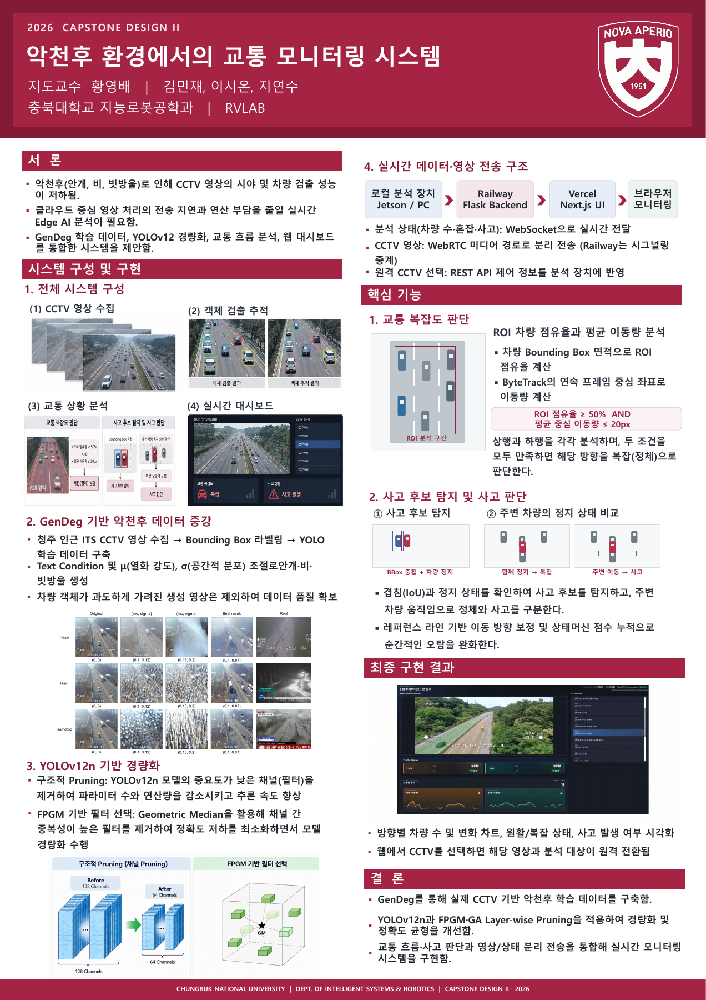

# 악천후 환경에서의 교통 모니터링 시스템

충북대학교 지능로봇공학과 캡스톤디자인 II · 지도교수 황영배 · 김민재, 이시온, 지연수

ITS 고속도로 CCTV와 저장 영상을 YOLOv12 경량화 모델로 검출·추적하고, ROI별 차량 수·교통 혼잡·사고 후보를 웹 대시보드에 표시합니다. GenDeg 악천후 데이터 증강, FPGM/GA 기반 모델 경량화, WebSocket 상태 전송과 WebRTC 영상 전송을 통합한 프로젝트입니다.

[웹 대시보드](https://detection-demo-noxay0g58-capstone11.vercel.app) · [환경 구축](docs/setup.md) · [폴더 안내](docs/structure.md)

## 졸업작품 포스터

[](assets/캡스톤디자인II_학술대회형_졸업작품포스터.pdf)

[포스터 PDF 원본 보기](assets/캡스톤디자인II_학술대회형_졸업작품포스터.pdf)

## 구조

```text
capstone_design/
├── main/                  # CCTV 추론 송신기와 로컬 대시보드
│   ├── backend/           # Railway Flask API·WebSocket·WebRTC 시그널링
│   ├── frontend/          # Vercel Next.js 대시보드
│   ├── utils/             # 검출·추적·ROI·분석·전송 모듈
│   ├── roi/               # CCTV별 ROI 설정
│   └── tests/             # 영상 전환·원격 제어·ROI 회귀 테스트
├── capstone_demo/         # USB 카메라 발표 시연, 사고 영상 모니터
├── models/                # cctv/ · camera/ · crash/ · experiments/ · pretrained/
├── data/videos/           # weather/ 악천후 영상 · crash/ 사고 영상
├── tools/                 # 영상 수집·ROI 설정·모델 비교·실행 검증
├── training/              # yolov12/ 학습 · yolov12_pruning/ 경량화 실험
├── experiments/           # crash_test/ 사고·heading·depth 실험
├── assets/                # 포스터 PDF·미리보기·데모 QR
└── docs/                  # 환경 구축·폴더 안내·설계 그림
```

## 환경 구축

검증 환경은 Linux x86_64, Python 3.10, PyTorch 2.2.2입니다. 로컬 영상 추론은 CPU로도 실행할 수 있습니다.

```bash
git clone https://github.com/Minjea31/capstone_design.git
cd capstone_design

git lfs install
git lfs pull

conda create -n capstone python=3.10 pip -y
conda activate capstone
python -m pip install --upgrade pip
python -m pip install -r requirements.txt
```

Git LFS가 없다면 먼저 설치해야 합니다. Ubuntu 시스템 패키지, GPU, 선택적 WebRTC, 별도 웹 서버 설치 방법은 [환경 구축 문서](docs/setup.md)에 있습니다.

YOLOv12는 고정된 커밋의 패키지로 설치합니다. `_deps`를 내려받거나 저장소 안에 다른 Git 저장소를 만들 필요가 없습니다.

## 실행

### 저장 영상으로 로컬 대시보드 실행

저장소 루트에서 실행합니다. 첫 악천후 영상으로 시작하며, 실시간 CCTV를 선택하면 ITS API에서 URL을 조회합니다.

```bash
python main/main.py --video-dir data/videos/weather --use-roi --port 5000
```

브라우저에서 `http://localhost:5000`에 접속합니다. 저장 영상 4개는 끝까지 재생되면 반복합니다. `2.avi`, `3.avi`, `10.avi`에는 확인된 CCTV ROI를 적용하며, `6.avi`는 촬영 방향이 달라 별도 ROI 설정이 필요합니다.

### 웹 대시보드 실행

```bash
DETECTION_BACKEND_URL=https://detection-demo-production.up.railway.app \
DETECTION_TRANSPORT=websocket \
DETECTION_WS_HTTP_FALLBACK=1 \
DETECTION_LOG_SEND=1 \
DETECTION_SEND_EVENTS_ONLY=0 \
DETECTION_SEND_INTERVAL=0.45 \
DETECTION_FRAME_WIDTH=720 \
DETECTION_JPEG_QUALITY=35 \
DETECTION_CONTROL_INTERVAL=3 \
DETECTION_CONTROL_TIMEOUT=2 \
python main/main.py --use-roi
```

영상 전송 옵션과 WebRTC 설정은 [송신기 안내](main/README.md), 개별 배포 방법은 [백엔드](main/backend/README.md)와 [프론트엔드](main/frontend/README.md)를 참고합니다. 기존 배포 루트 `main/backend`, `main/frontend`는 유지했습니다.

### USB 카메라 발표 시연

```bash
python capstone_demo/main.py --roi-use --device cpu
```

`http://localhost:8000`에서 확인합니다. Logitech C920이 기본 카메라이며, `--camera 0`처럼 직접 선택할 수 있습니다. 사고 영상은 `data/videos/crash`를 함께 사용합니다. 상세 옵션은 [시연 안내](capstone_demo/README.md)에 있습니다.
